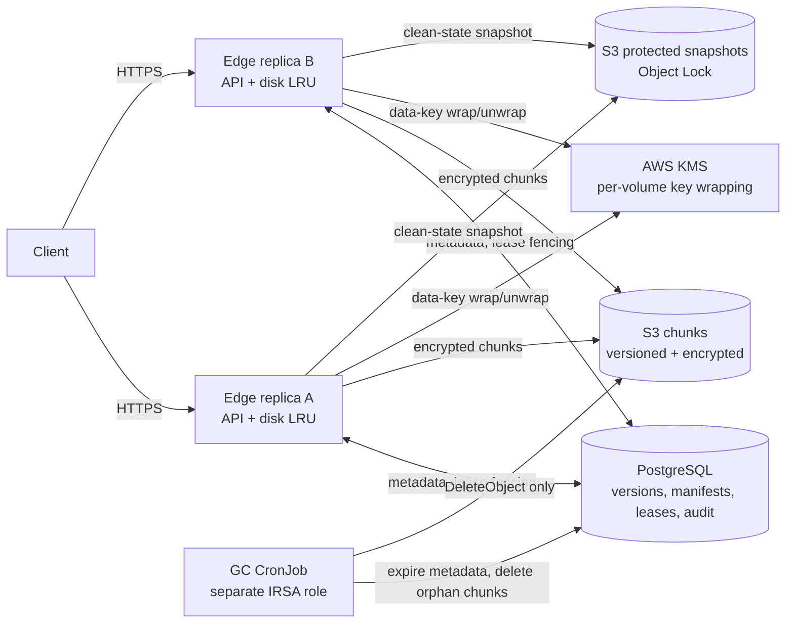

# EdgeVault architecture

## Write and recovery flow

An edge obtains a lease for the path and receives a monotonically increasing fencing token. It splits the payload into 4 MiB blocks, computes per-volume HMAC chunk IDs, compresses eligible data, encrypts each chunk with AES-256-GCM, and writes chunk objects before opening the metadata commit transaction. The transaction validates the fencing token and `If-Match`, then publishes the ordered manifest as a new version and advances the volume commit sequence. A stale edge cannot publish after a lease has been reclaimed; its rejected payload is kept as a conflict copy.

Reads resolve a version manifest from PostgreSQL, then fetch and authenticate/decrypt its chunks, using the disk LRU when available. Each successful write adds an entropy/path signal to a PostgreSQL 60-second window shared by all edge replicas. When the threshold is reached, a transaction opens the volume alert so concurrent commits are rejected; the edge then records the clean state in the protected snapshot bucket. Restore creates new versions from that state, so the ordinary version history remains available.

GC expires only manifests outside the per-volume retention window, newest-version floor, and protected snapshot states. It pauses for volumes under ransomware alerts. For chunk deletion it rechecks references while holding the chunk metadata row lock; an upload racing with deletion waits, notices the missing metadata row, and re-uploads the bytes before commit.

## Deployment boundary

The EKS workload has two edge replicas with separate persistent cache volumes and a shared PostgreSQL/S3/KMS backend. Edge and GC use separate Kubernetes service accounts and IRSA roles. Edge can read/write chunks and write protected snapshots; it cannot delete objects. GC can delete chunk objects only. The GC CronJob starts in dry-run mode. Terraform defines the AWS resources, but applying it and collecting cluster measurements are explicit deployment steps described in the [README](../README.md).
